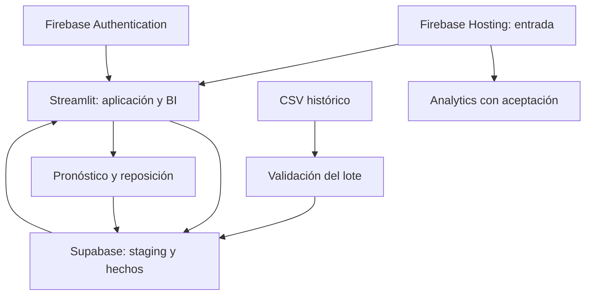

# Arquitectura, datos e indicadores

## Servicios

La información operativa persiste en Supabase. Streamlit ejecuta la aplicación y el análisis en la nube. Firebase Hosting publica HTML/CSS/JavaScript y abre el dashboard en su URL propia; no se intenta ejecutar Python dentro de Hosting. Firebase Authentication identifica al personal. Google Analytics mide solo la página pública y su enlace de acceso.

## Modelo comercial normalizado

El grano de ventas es **una línea de producto por ticket**. Un ticket puede tener varias líneas; se cuenta una sola vez al calcular ticket promedio. La categoría y el proveedor se normalizan fuera del producto, formando un modelo analítico con ramificaciones de dimensiones. Las ventas y los movimientos son hechos diferentes y nunca se suman indiscriminadamente.

| Objeto | Función |
|---|---|
| `bodega_categorias` | Dimensión de categoría |
| `bodega_proveedores` | Dimensión de proveedor de referencia del artículo |
| `bodega_productos` | Dimensión operativa de producto y existencia actual |
| `bodega_tiempo` | Dimensión diaria de fecha, mes, año y día de semana |
| `bodega_ventas` | Cabecera del ticket, fecha de Lima, pago, origen y estado |
| `bodega_detalle_venta` | Hechos por línea: cantidad, precio, costo, descuento, ingreso y margen |
| `bodega_movimientos` | Entradas/salidas, ajustes, mermas y stock resultante |
| `bodega_operaciones` | UUID, payload y resultado para reintentos idempotentes |
| `bodega_lotes` | Nombre, hash, número de filas y estado del archivo |
| `bodega_staging` | Filas validadas del lote en JSON para transformación/carga |
| `bodega_predicciones` | Unidades pronosticadas, corte, método y WAPE |
| `bodega_reposiciones` | Decisión, motivo y contexto de la sugerencia |
| `bodega_eventos` | Eventos de uso de la aplicación, sin datos de compradores |
| `bodega_v_ventas` | Vista semántica para BI, con ventas completadas |

Las dimensiones de producto/categoría/proveedor reflejan los valores actuales al consultar. El precio y costo de cada venta sí se preservan como instantánea. No se implementan dimensiones con historia de cambios tipo SCD 2: si se reclasifica un producto, sus ventas previas se mostrarán con su categoría vigente.

## Reglas operativas

- **Venta POS:** obtiene precio y costo desde el servidor, bloquea productos en orden de ID, valida stock y registra cabecera, líneas y movimientos en una sola transacción. Si una línea falla, no se guarda ninguna parte del ticket.
- **Reintento:** una operación con el mismo UUID y payload devuelve su resultado anterior; un UUID con datos distintos se rechaza. El cliente conserva el UUID ante falta de confirmación, mientras su sesión permanezca activa.
- **Entrada:** suma stock y calcula costo promedio ponderado del saldo previo y la compra recibida.
- **Ajuste:** la cantidad ingresada es el total físico contado; la variación calculada queda en el kardex con motivo.
- **Merma:** resta unidades dañadas y registra motivo; no hay control de caducidad por lote en este MVP.
- **Anulación:** excluye el ticket del BI. Si era POS, restituye unidades una vez. Si era histórico, no toca stock actual.
- **Historial:** validación completa antes de staging; proceso transaccional. Hash evita repetir el mismo archivo y ticket externo único evita duplicación entre archivos.
- **Reposición:** aceptar/descartar registra una decisión con contexto y motivo; no cambia inventario ni envía pedidos.

El SQL concede tablas, vista y RPC comerciales exclusivamente a `service_role` y revoca ejecución de esas funciones a `public`, `anon` y `authenticated`. La cuenta Firebase y su rol se verifican en Python antes de usar la clave del servidor. No se expone una clave privada en `hosting/`.

## Catálogo de KPI

| Indicador | Cálculo | Interpretación |
|---|---|---|
| Ventas netas | Σ(cantidad × precio − descuento de línea) | Ingreso registrado en soles del período filtrado |
| Tickets | Tickets únicos con líneas en el filtro | Si filtras categoría, cuenta tickets con esa categoría |
| Ticket promedio | Ventas filtradas / tickets únicos filtrados | Importe medio del conjunto seleccionado |
| Margen bruto estimado | Σ(ingreso − cantidad × costo registrado) | No descuenta gastos ni calcula utilidad neta |
| Valor del inventario | Σ(stock actual × costo actual) | Existencias valoradas a referencia actual |
| Stock bajo | Activos con stock ≤ mínimo | Estado presente, independiente del filtro de fechas |
| Velocidad | Unidades vendidas en 28 días / 28 | Venta realizada por día calendario, no demanda total |
| Objetivo de stock | max(mínimo, ceil(velocidad × (plazo + cobertura))) | Regla explicable para revisar compras |
| Unidades por comprar | max(0, objetivo − stock) | No considera pedidos pendientes |
| WAPE | Σ\|real − pronóstico\| / Σ\|real\| | Menor es mejor; sin ventas positivas es indefinido |
| Índice de exactitud | 100 × (1 − WAPE) | Puede ser negativo; no es certeza ni probabilidad |

## Protocolo del pronóstico

1. Seleccionar un producto y un período completo de al menos 84 días. El usuario certifica que días sin líneas son ceros reales de ventas; si hubo faltantes o registros omitidos, se detiene la evaluación hasta delimitar/corregir el período.
2. Reservar los últimos 28 días; usar los anteriores para entrenar (mínimo 56).
3. Calcular referencias de promedio de los últimos 28 días y repetición de la semana anterior.
4. Entrenar Random Forest con lags 1/7/14, promedios de 7/28 días y calendario. No se utiliza cantidad futura ni variables derivadas de la venta a pronosticar.
5. Pronosticar recursivamente todo el bloque sin introducir sus observaciones en los lags. Comparar WAPE agregado del producto.
6. Usar Random Forest solo si supera estrictamente al mejor método sencillo; en empate conservar la referencia.
7. Reentrenar el método seleccionado con los datos hasta el corte y pronosticar 7, 14 o 28 días posteriores.
8. Guardar resultados cuando el usuario confirme.

La selección del método usa ese mismo bloque: corresponde a **validación preliminar**. Para el informe final del piloto reserva un bloque adicional independiente, o realiza evaluación temporal de ventanas múltiples. La declaración del usuario sobre cobertura no sustituye una auditoría de ventas y faltantes. No se promete alcanzar 80 % con datos ficticios ni con cualquier artículo.
