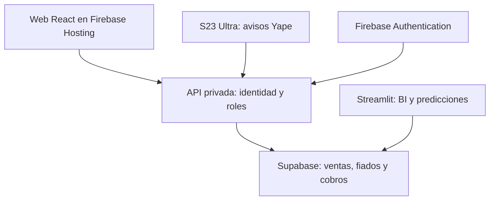

# Ruta propuesta hacia una web propia

La recomendación para Bodega Marga es una interfaz propia en React, publicada como archivos web en Firebase Hosting, conservando Firebase Authentication y Supabase. El BI puede continuar inicialmente en Streamlit mientras se migran caja, clientes y fiados. Esta entrega prepara reglas transaccionales reutilizables; todavía no implementa ni despliega esa interfaz React.

Cambiar de alojamiento no corrige por sí solo una consulta lenta. Una web propia permite actualizar únicamente la parte necesaria de la pantalla; hay que conservar además consultas acotadas, índices, conexiones reutilizadas y mediciones de red/servidor. No se promete una velocidad concreta sin medir el despliegue real.

## Opciones de alojamiento consultadas

| Opción | Aporte para el proyecto | Condición |
| --- | --- | --- |
| Firebase Hosting | Reutiliza el proyecto actual, entrega el frontend por CDN, HTTPS y subdominio `web.app`. Es la opción recomendada por continuidad. | Nivel gratuito con cuotas de almacenamiento y transferencia. No es un servidor Python ni sustituye el backend privado. |
| Cloudflare Pages | Alternativa para publicar archivos de una web React, con subdominio `pages.dev`. | Las solicitudes de recursos estáticos son gratuitas; las funciones tienen sus propias cuotas. No garantiza que toda la solución sea ilimitada o sin costo. |
| Vercel Hobby | Puede servir para una prueba personal no comercial. | Su plan Hobby restringe el uso a proyectos personales no comerciales; no se recomienda como plan gratuito definitivo para operar la bodega. |

Firebase Hosting documenta 10 GB de almacenamiento y 10 GB/mes de transferencia sin costo al momento de la consulta. Si se supera una cuota, el comportamiento depende del plan. No hay que confundir Firebase Hosting con Firebase App Hosting, Cloud Functions o Cloud Run, que tienen requisitos y costos propios.

Un subdominio gratuito como `bodega-marga-bi.web.app` no equivale a obtener gratuitamente un dominio propio `.com` o `.pe`. La dirección concreta depende del sitio de Hosting que se configure. No se ha publicado aquí una nueva web ni se ha adquirido un dominio.

## Arquitectura propuesta

El servidor valida el token Firebase, el correo verificado y el rol antes de ejecutar operaciones. El navegador no recibe la clave `service_role`. Las llamadas a las funciones SQL se limitan a una lista explícita; el usuario auditado proviene de la identidad verificada, no de un campo enviado por el cliente.

Supabase permite integrar Firebase como proveedor de autenticación externo. Otra vía es mantener las tablas privadas y pasar por una API que valide Firebase. Esa es la vía propuesta para reutilizar los RPC actuales sin abrir acceso directo a todos los datos. La elección y sus políticas deben implementarse antes de conectar un frontend público a la base real.

## Orden de migración

1. **Consolidar reglas y datos:** clientes, ventas, fiados, abonos, referencia única y órdenes de cobro; probarlas en la app actual con cuentas reales autorizadas y pruebas controladas.
2. **Preparar API y entorno de pruebas:** rutas de catálogo, clientes, cuentas de fiado, órdenes y confirmaciones; verificación de roles en servidor; respuestas de error estables; pruebas de reintentos y concurrencia.
3. **Construir frontend propio:** login, catálogo conservando la línea visual actual, carrito, ventana de cobro, tickets, historial y fiados. Las cuentas de clientes en un portal externo requerirían permisos propios separados de los empleados.
4. **Publicar una versión paralela en Hosting:** validar inicio de sesión, roles, stock, ventas, abonos, uso móvil y tiempos de respuesta. Las pruebas no deben crear ventas duplicadas en la base real.
5. **Migrar el uso operativo:** sustituir el acceso principal cuando estén comprobadas las funciones; mantener el acceso al BI en Streamlit durante la transición.

El evento de un proveedor bancario o pasarela autorizado podría permitir una confirmación automática después de comprobar su autenticidad, identificador, importe, moneda y destinatario. Los avisos de un celular personal mantienen el estado «Detectado» hasta su revisión. La migración a React no cambia esa diferencia.

Referencias oficiales consultadas el 24 de octubre de 2026:

- [Firebase Hosting: subdominios, HTTPS y CDN](https://firebase.google.com/docs/hosting)
- [Firebase Hosting: cuotas y precios](https://firebase.google.com/docs/hosting/usage-quotas-pricing)
- [Cloudflare Pages: cuotas](https://developers.cloudflare.com/pages/platform/limits/)
- [Cloudflare Pages: recursos estáticos y funciones](https://developers.cloudflare.com/pages/functions/pricing/)
- [Vercel Hobby: condiciones del plan](https://vercel.com/docs/plans/hobby)
- [Supabase: Firebase Auth](https://supabase.com/docs/guides/auth/third-party/firebase-auth)
- [Yape: identificar un yapeo falso](https://www.yape.com.pe/preguntas-frecuentes/enviar-y-recibir-yapeos/como-identifico-un-yapeo-falso)
